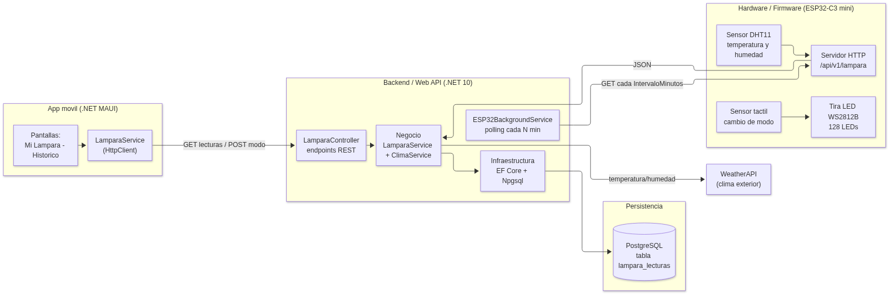

# Proyecto Lámpara LED 2026

Lámpara LED inteligente basada en ESP32 que mide la temperatura y humedad del ambiente,
la compara con el clima exterior (WeatherAPI) y permite controlar el modo de iluminación
desde una aplicación móvil. Integra tres áreas: **Microcontroladores II**, **Programación
Web** y **Aplicaciones Móviles**.

## Arquitectura

El sistema tiene tres partes que trabajan juntas: el firmware del ESP32, una API REST en
.NET y una app móvil en .NET MAUI.




+-------------------------------+              +-------------------------------+
| Hardware / Firmware           |              | Backend / Web API (.NET 10)   |
| (ESP32-C3 mini)               |              +-------------------------------+
|                               |                    |                    |
|  DHT11 --temp/humedad--> HTTP |  JSON estado       |  LamparaService    |
|  Sensor tactil --> LED strip  | <--- /api/v1/lam.. |  + ClimaService    |
|  WS2812B x128                 |                    |  EF Core + Npgsql  |
|                               |                    |  ESP32Background   |
|  WebServer :80 <--------------+-- GET /modo?id=N   |  (polling c/ N)    |
+-------------------------------+                    +----------+---------+
                                                                |         |
                                                                v         v
                                                       +------------+ +------------+
                                                       | WeatherAPI | | PostgreSQL |
                                                       | clima ext. | | lampara_   |
                                                       +------------+ | lecturas   |
                                                                      +------------+

   +---------------------------+       +---------------------+
   | App movil (.NET MAUI)     | ----> | LamparaController   | ---> Negocio
   | Pantallas + HttpClient    | GET/  +---------------------+
   +---------------------------+ POST


### Flujo del dato

1. El ESP32 lee el DHT11 cada 5 segundos y expone un servidor HTTP con el estado actual
   (temperatura, humedad y modo de luz).
2. La API consulta al ESP32 periódicamente (`ESP32BackgroundService`, configurable con
   `ESP32:IntervaloMinutos`), enriquece la lectura con el clima exterior de WeatherAPI y
   guarda todo en PostgreSQL.
3. La app móvil consume la API: muestra la última lectura, el histórico con gráficos y
   permite cambiar el modo de la lámpara.
4. Para cambiar el modo, la app hace `POST /api/v1/Lampara/modo`, la API reenvía la orden
   al ESP32 (`GET /api/v1/lampara/modo?id=N`) y la lámpara aplica el color.

### Modos de iluminación

| ID | Modo                | Descripción                                                 |
|----|---------------------|-------------------------------------------------------------|
|  1 | Full                | Blanco completo                                             |
|  2 | Luz Tenue           | Blanco al ~23% de intensidad                                |
|  3 | Lámpara Temperatura | Color según temperatura: azul/celeste (frío) → rojo (calor) |
|  4 | Apagado             | LEDs apagados                                               |

El modo también se puede cambiar físicamente tocando el sensor táctil del ESP32.

## Tecnologías utilizadas

- **Hardware**: ESP32-C3 mini, sensor DHT11 (temperatura/humedad), tira de LEDs WS2812B
  (128 LEDs), sensor táctil capacitivo
- **Firmware**: C++ (Arduino core ESP32), FastLED, DHT, Bounce2, WebServer, NTP
- **Backend**: C#, .NET 10, ASP.NET Core Web API, Entity Framework Core, Npgsql
- **Base de datos**: PostgreSQL
- **API externa**: WeatherAPI (clima actual de la ubicación configurada)
- **App móvil**: .NET MAUI (Android / iOS / Windows / MacCatalyst), CommunityToolkit.Mvvm,
  Microcharts + SkiaSharp para gráficos

## Estructura del repositorio

```
├── firmware/LamparaLed_ESP32/   # Código Arduino del ESP32 (.ino)
├── api/LamparaLedAPI/           # Solución .NET en capas: Presentacion / Negocio / Infraestructura
├── app/LamparaApp/              # Solución .NET MAUI (AppLamparaLed)
├── docs/                        # Documentación técnica (arquitectura, contrato de API)
├── capturas/                    # Capturas de pantalla de la app (app/capturas)
└── proyectolapmara2026.drawio   # Diagrama original del proyecto
```

La API sigue una **arquitectura en capas** con dependencias en un solo sentido:
`Presentacion → Negocio → Infraestructura`.

- **Presentacion**: controllers REST, `Program.cs` (DI, pipeline) y
  `ESP32BackgroundService` (polling al ESP32).
- **Negocio**: `LamparaService` (orquesta guardado y consultas) y `ClimaService`
  (WeatherAPI).
- **Infraestructura**: `LamparaDbContext` (EF Core), `LamparaRepository`, `ESP32Client`
  (HttpClient hacia el ESP32) y migraciones.

## Requisitos previos

- [.NET 10 SDK](https://dotnet.microsoft.com/download)
- **Para la app MAUI**: Android SDK + JDK 17 (o workloads de .NET MAUI instalados con
  `dotnet workload install maui`)
- **Para el firmware**: Arduino IDE 2.x con el core de ESP32 (ESP32C3) y las librerías
  FastLED, DHT sensor library, Bounce2
- **Base de datos**: PostgreSQL corriendo localmente (o accesible por red)
- Un ESP32-C3 con el circuito armado (ver `firmware/README.md`)

## Cómo ejecutar

### 1. Base de datos

Crear la base `lamparadb` en PostgreSQL. Las tablas se crean con las migraciones de EF Core
automáticamente al primer `GET`/`POST` si la base existe, o manualmente con:

```bash
cd api/LamparaLedAPI/Presentacion
dotnet ef database update
```

### 2. API

```bash
cd api/LamparaLedAPI
dotnet run --project Presentacion
```

La API queda escuchando en `http://0.0.0.0:5000` (todas las interfaces, para que la app y
el ESP32 la alcancen desde la red local). En desarrollo, OpenAPI/Swagger está disponible.

### 3. App móvil

```bash
cd app/LamparaApp/AppLamparaLed
dotnet build AppLamparaLed -f net10.0-android
# o desde Visual Studio: proyecto AppLamparaLed -> Ejecutar en emulador/dispositivo Android
```

### 4. Firmware

1. Abrir `firmware/LamparaLed_ESP32/LamparaLed_ESP32.ino` en Arduino IDE.
2. Configurar `ssid` y `password` de tu WiFi (líneas ~61-62 del `.ino`).
3. Seleccionar placa **ESP32C3 Dev Module** y el puerto correspondiente.
4. Subir el sketch. Anotar la IP que imprime el Monitor Serie.

## Configuración

Todos los valores dependen de la red local, hay que ajustarlos:

|                               Dónde                                |               Qué               |               Valor actual               |
|--------------------------------------------------------------------|---------------------------------|------------------------------------------|
| `api/.../appsettings.json` → `ConnectionStrings:DefaultConnection` | Cadena de conexión a PostgreSQL | `Host=localhost;...`                     |
| `appsettings.json` → `ESP32:BaseUrl`                               | IP del ESP32                    | `http://192.168.1.102`                   |
| `appsettings.json` → `ESP32:IntervaloMinutos`                      | Frecuencia de polling al ESP32  |  `30`                                    |
| `appsettings.json` → `WeatherAPI:ApiKey` / `Ubicacion`             | Clima exterior                  | ver archivo                              |
| `firmware .ino` → `ssid` / `password`                              | WiFi del ESP32                  | placeholder                              |
| `app/.../Services/LamparaService.cs` → `ApiUrl`                    | IP de la PC donde corre la API  | `http://192.168.1.9:5000/api/v1/lampara` |

> **Importante**: la PC que corre la API y el celular deben estar en la misma red WiFi, y la
> API debe escuchar en `0.0.0.0` (ya configurado en `Program.cs`).

## Estado del proyecto

**Hecho:**
- Firmware: servidor HTTP en el ESP32, 4 modos de luz, cambio por sensor táctil, lectura
  DHT11 cada 5 s, hora por NTP.
- API: endpoints REST, polling automático al ESP32, persistencia en PostgreSQL,
  integración con WeatherAPI.
- App: pantallas **Mi Lámpara** (estado actual, comparación interno/externo, cambio de
  modo) e **Histórico** (gráficos de temperatura/humedad por día, semana y mes).

**Pendiente / a mejorar:**
- La app incluye páginas y modelos del template de MAUI que todavía no se usan
  (`MainPage`, `ProjectListPage`, `TaskDetailPage`, etc.).
- No hay autenticación en la API.
- Las credenciales de red y la API key están en texto plano en los archivos de
  configuración (usar placeholders o variables de entorno).

## Documentación adicional

- [Arquitectura detallada](docs/arquitectura.md)
- [Contrato de la API](docs/contrato-api.md)
- [README de firmware](firmware/README.md) · [README de la API](api/README.md) ·
  [README de la app](app/README.md)

## Autor

Ivar Sosa — Proyecto integrador Lámpara LED 2026.
