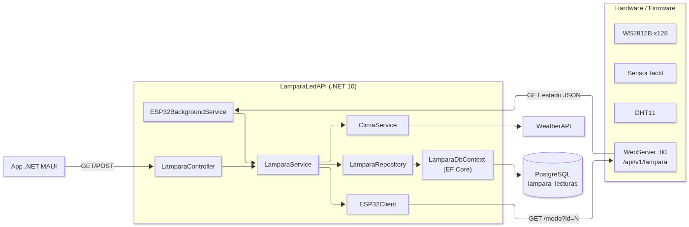

# Arquitectura — Proyecto Lámpara LED 2026

Documento técnico de la arquitectura del sistema. Para una vista general ver el
[README principal](../README.md).

## Vista general

+-------------------+        +--------------------------+
|  Hardware /       |        |  LamparaLedAPI (.NET 10) |
|  Firmware (ESP32) |        +--------------------------+
|                   |                   |                   |
|  +-------------+  |   GET estado      |  LamparaService   |
|  | DHT11       |  |<--- JSON ---------|                   |
|  | Tactil      |  |                   |-----+-------------|
|  | WS2812B x128|  |                   |     |             |
|  | WebServer:80|  |<-- GET /modo?id=N |     |             |
|  | /api/v1/... |  |                   |     |             |
|  +-------------+  |                   v     v             v
+-------------------+             +---------+ +--------+ +--------+
                                  |ClimaSvc | |Repo    | |ESP32   |
                                  +----+----+ +---+----+ |Client  |
                                       |          |      +---+----+
                                       v          v          |
                                  +----------+ +---------------------+
                                  |WeatherAPI| | PostgreSQL          |
                                  +----------+ | lampara_lecturas    |
                                               +---------------------+

   +------------------+
   | App .NET MAUI    |-- GET/POST --> LamparaController --> LamparaService
   +------------------+

## Capas de la API

La solución `api/LamparaLedAPI` está dividida en tres proyectos con dependencias
unidireccionales `Presentacion → Negocio → Infraestructura`:

### Presentacion

- **`LamparaController`** (`api/v1/Lampara`): expone los endpoints REST. Recibe el JSON
  crudo (`JsonElement`) y delega todo al servicio de negocio.
- **`ESP32BackgroundService`**: `BackgroundService` que cada
  `ESP32:IntervaloMinutos` (30 min por defecto) llama a `ConsultarESP32Async()`, que pide
  los datos al ESP32 y los persiste. Crea un scope de DI en cada iteración.
- **`Program.cs`**: registra `LamparaDbContext` (Npgsql), los servicios de negocio e
  infraestructura, y escucha en `http://0.0.0.0:5000` para ser accesible desde la red.

### Negocio

- **`LamparaService`**: punto de orquestación.
  - `ProcesarDatosLampara(json)`: deserializa el JSON del ESP32, consulta el clima actual a
    WeatherAPI (si falla, guarda la lectura igual con valores en 0) y persiste la entidad.
  - `ConsultarESP32Async()`: pide los datos al ESP32 vía `ESP32Client` y los procesa.
  - `CambiarModoLamparaAsync(modoId)`: reenvía la orden al ESP32.
  - `ObtenerTodasLecturas()` / `ObtenerUltimaLectura()`: consultas de lectura.
- **`ClimaService`**: consume `api.weatherapi.com/v1/current.json` con la `ApiKey` y la
  `Ubicacion` configuradas; devuelve temperatura y humedad.

### Infraestructura

- **`LamparaDbContext` / `LamparaEntity`**: EF Core sobre PostgreSQL. Tabla
  `lampara_lecturas` con columnas: `Id`, `FechaHora`, `DispositivoId`,
  `TemperaturaSensor`, `HumedadSensor`, `TemperaturaApi`, `HumedadApi`, `EstadoLampara`.
- **`LamparaRepository`**: `GuardarLectura`, `ObtenerTodasLecturas`, `ObtenerUltimaLectura`.
- **`ESP32Client`**: `HttpClient` tipado hacia `ESP32:BaseUrl`. Expone
  `ObtenerDatosLamparaAsync()` (`GET /api/v1/lampara`) y
  `CambiarModoLamparaAsync(id)` (`GET /api/v1/lampara/modo?id=N`).
- **`WeatherAPI/ConectorWeatherAPI`**: cliente alternativo del conector de clima.
- **`Migrations/`**: migraciones EF Core (incluye consolidación de tablas y cambio a
  `timestamp without time zone`).

## Flujo del dato de punta a punta

1. **Adquisición (ESP32)**: el DHT11 se lee cada 5 s (`intervalAPI = 5000`). El sensor
   táctil (`Bounce2`) cicla `funcionActual` entre 1 y 4 y aplica el modo al instante.
2. **Exposición (ESP32)**: el `WebServer` del ESP32 escucha en el puerto 80:
   - `GET /api/v1/lampara` → JSON con `fecha_hora`, `dispositivo`, `temperatura`,
     `humedad`, `lampara` (estado actual).
   - `GET /api/v1/lampara/modo?id=N` → cambia el modo (1-4) y responde confirmación.
   La hora se obtiene por NTP (`pool.ntp.org`, UTC-3 Argentina).
3. **Ingesta (API)**: el `ESP32BackgroundService` hace polling al endpoint del ESP32 cada
   `IntervaloMinutos`. También existe `POST /api/v1/Lampara` para que el ESP32 (u otro
   cliente) empuje datos directamente.
4. **Enriquecimiento y persistencia**: `LamparaService` agrega temperatura/humedad del
   clima exterior (WeatherAPI, ubicación configurable) y guarda la fila en
   `lampara_lecturas`.
5. **Consumo (app)**: la app MAUI llama a los endpoints `GET` de la API y muestra los
   datos; para actuar llama a `POST /api/v1/Lampara/modo`, que la API traduce a una
   llamada HTTP al ESP32.

## Decisiones técnicas

- **Arquitectura en capas**: separa HTTP (controllers), reglas/orquestación (servicios) y
  acceso a datos/HTTP externo (repositorios y clientes). Facilita probar y mantener.
- **Polling en lugar de push**: el ESP32 no empuja datos; la API lo consulta periódicamente.
  Más simple de implementar, a costa de latencia (hasta `IntervaloMinutos`) y de que el
  ESP32 deba tener IP fija o DNS en la red.
- **EF Core + Npgsql**: migraciones versionadas de la tabla de lecturas; el snapshot del
  modelo permite evolucionar el esquema.
- **WeatherAPI del lado del servidor**: la app no necesita la API key; el backend enriquece
  cada lectura con el clima de referencia.
- **Modo degradado**: si WeatherAPI falla, la lectura se guarda igual (clima en 0) — no se
  pierde el dato del sensor.
- **MVVM manual en la app**: los `PageModel` implementan `INotifyPropertyChanged` a mano
  (hay `CommunityToolkit.Mvvm` disponible pero no se usa en estas pantallas).

## Modo de iluminación por temperatura (firmware)

Cuando `funcionActual == 3`, el color se calcula con `colorPorTemperatura(temp)`:

- Temperatura acotada a **10–40 °C**.
- **10–20 °C**: degradado azul→verde (`CRGB(0, verde, azul)`), más frío = más azul.
- **20–40 °C**: degradado verde→rojo (`CRGB(rojo, verde, 0)`), más calor = más rojo.
- Se actualiza en cada ciclo de lectura del DHT (5 s), así que el color sigue a la
  temperatura en vivo.
